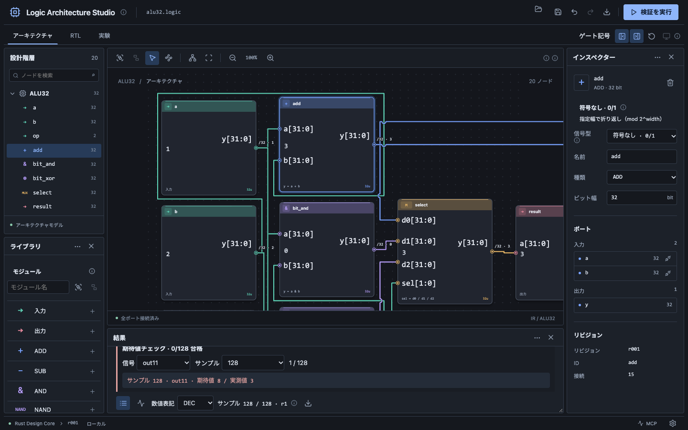

# Logic Architecture Studio



Tauri 2 + Rustで実装した、回路編集とMCP操作を同じ設計コアで扱うEDAワークベンチの初期実装です。UNGEのノード表現とネイティブGPUレンダラーを取り込んでいます。

[English](docs/README.en.md) · [简体中文](docs/README.zh-CN.md) · [実装状況](ROADMAP.md) · [アーキテクチャ](docs/ARCHITECTURE.md) · [MCP](docs/MCP.md)

## 起動

Node.js 22以上、Rust 1.99以上、macOSのXcode Command Line Toolsを使用します。現在のIPC実装はUnixソケットです。Windowsは未対応です。

```sh
npm ci
npm run desktop
```

TauriがRust Design Coreを起動します。開発時はプロジェクトの `.logic/`、リリース版はアプリデータディレクトリの `workspace/.logic/` に保存します。既存のコアが同じワークスペースで動いている場合は再利用します。`--workspace PATH` または `LAS_WORKSPACE` でワークスペースを明示できます。macOS版では左上のフォルダーボタンから別のワークスペースを選択でき、選んだ場所を次回起動時にも開きます。

ブラウザーでUIを開く場合は、二つのターミナルを使用します。ブラウザー版でもRustコアが必要です。

```sh
npm run core
# 別のターミナル
npm run dev
```

`http://127.0.0.1:1420` を開きます。ブラウザー版のネイティブ分離ウインドウ／GPUボタンは無効です。

## 現在使える機能

- Input / Output / Add / Sub / AND / OR / XOR / NOT / 3入力Mux、1〜64 bit。
- ノード追加・移動・選択・削除、出力→入力接続、接続解除、属性編集、自動整列、拡大縮小。
- 役割別ヘッダー、ポートリング、Bezier配線、選択リング、接続先候補表示。表示とポートの当たり判定は同じ座標を使用。
- 接続のビット幅、多重ドライバー、ID、組合せループの検査。途中の未接続状態は編集可能。
- 原子的パッチ、リビジョン競合検出、Undo/Redo、ディスク保存失敗時のロールバック。
- 検証可能な回路からVerilog-2005生成・保存。64 bitの入出力値は文字列で授受。
- ALU仕様の320ベクトル検証、任意テストベクトル、単発信号評価。
- 最大8候補の分岐・同一条件での検証・比較・採用。内蔵比較例は回帰検出用の意図的な変異です。
- パネルのドラッグ／メニューによる左右・下へのドッキング。Tauriでは独立ウインドウへの分離。
- 英語・日本語・简体中文のUI。
- stdio MCPのTools / Resource / Prompt。読み取り専用が既定。
- Yosys検出・固定引数による合成アダプター。未導入なら実行不可と表示。
- 組み合わせALUの形式検証。結果パネルのYosys行、またはMCPの `verify.formal` から実行できます。
- Icarus／Verilatorによる生成RTLの実行とRust／期待値との照合。結果パネルの「ツール」から実行でき、MCPでは `verify.rtl` を利用できます。詳細は [RTL検証](docs/RTL-VERIFICATION.md)。
- UNGEによるRust/wgpuネイティブ表示。ノード・配線・文字はGPU側で描画し、フレーム画像をJSへ転送しません。

## 操作

ノードの出力ポート `y` をクリックし、続けて接続先の入力ポートをクリックします。接続モードで配線をクリックすると解除します。Escapeで接続を中止します。ノードはドラッグで移動します。Shift／⌘／Ctrl＋クリックで選択を追加・解除し、背景の左ドラッグで範囲選択できます（最大512ノード）。選択中のノードをドラッグするとまとめて移動し、1回のUndoで戻せます。背景の右／中ドラッグはパンです。ドラッグしたノードの左上が背景ドットにスナップします（通常24間隔、縮小時120間隔）。複数選択時はつかんだノードを基準に相対位置を保ちます。選択後は右パネルで名前・種類・幅を変更します。Undoは `⌘Z` / `Ctrl+Z`、RedoはShiftを併用します。

デモALUの仕様は `op=0: a+b`、`op=1: a&b`、`op=2/3: a^b`、結果はビット幅で切り詰めます。仕様を変える回路にはMCP/APIから明示的なテストベクトルを渡してください。組込み検証は形式証明やRTLシミュレーターとの等価性証明ではありません。

設計変更後の検証結果には「更新が必要」と表示します。面積・遅延・電力は未計測のため埋めません。

## 検証とビルド

```sh
npm run build
cargo fmt --all -- --check
cargo test --workspace --locked
cargo clippy --workspace --all-targets --locked -- -D warnings
cargo test -p studio-service --test interop -- --ignored
cargo test -p studio-renderer --test gpu -- --ignored
npm run bundle -- --debug --bundles app
```

GPUテストは実GPUとCJKフォント、IPCテストはUnixソケットの使用許可が必要です。GPUテストだけが検証用ピクセルを読み戻します。通常描画では画像readbackをしません。

## 境界

デスクトップ版はメインウインドウの左側をUNGEのネイティブGPU編集領域、右側をWebView操作パネルにしています。選択・ドラッグ移動・ポート間ドラッグ接続・背景の右ドラッグによるパン・ホイールズームはRust側で処理します。確定した変更は共有設計サービスのリビジョン検査を通ります。ブラウザー版はSVG編集経路を維持します。巨大ネットリスト向けの性能保証はありません。

内蔵LLM、MCPクライアント、自律探索エージェント、OpenROAD、PDK、実機書込みは未実装です。Yosysアダプターはプロセス実行時間と生成スクリプトを制限しますが、OSレベルのサンドボックスではありません。標準セル面積・タイミング評価は行いません。

現在のドキュメントは単一モジュールの組合せDAGです。FF・クロック・階層・HDL再インポート・波形トレース・複数プロジェクトGUI・差分ベース大容量履歴は今後の実装です。製造用EDAフローの完成版ではありません。

[UNGEのライセンスと出典](THIRD_PARTY_NOTICES.md)を参照してください。`.gitignore` はビルド成果物、ローカル状態、ソケット、EDA波形、秘密情報、テスト出力を除外し、アプリのロックファイルは追跡対象としています。

## 設計ファイルの退避・復元

上部の保存アイコンで `.logic` 設計ファイルを書き出し、フォルダーアイコンで読み込めます。読み込みは現在の設計を置き換え、Undoで戻せます。ファイルのスキーマ・接続・ビット幅・循環をRust側で検証し、編集中にリビジョンが変わった場合は拒否します。書き出すのは回路と配置です。検証結果・実験履歴・設定はローカルワークスペースに保持します。

Undo/Redoは合算100件・シリアライズ後16 MiB以内に制限します。これは履歴データの上限であり、プロセス全体のメモリ上限ではありません。

## ネイティブパネル配置

ライブラリ・インスペクター・結果は、各パネルの「···」メニューから左・右・下へドッキング、またはフローティングできます。同じ領域に複数配置すると分割表示します。「×」と分離ウインドウのOS閉じるボタンはパネルを非表示にし、上部のパネル名ボタンで再表示できます。同じWebViewを移動するため、タブや入力途中の値を維持します。再表示先はワークスペースに保存され、再起動後も維持します。ネイティブ版はメニュー操作と見出しドラッグで領域間を移動でき、境界バーで分割幅・高さを変更できます。

## ドラッグでの配置とサイズ調整

デスクトップ版ではパネル見出しをドラッグし、ウインドウ左側・右側・下側で離すとドッキングします。中央など対象外では配置を変更しません。左右と下の細い境界バーをドラッグすると幅・高さを調整できます。寸法はRust側に保持し、現在の画面サイズで上限を制限します。Escapeやフォーカス喪失で操作を中止できます。配置・開閉状態・左右幅・下領域高さ・フローティング位置とサイズは操作時に自動保存し、再起動時に復元します。領域寸法と分離ウインドウの情報は `.logic/panel-layout.json`、開閉・配置モードは `.logic/workspace.json` に保持します。画面外の分離ウインドウは利用可能な画面内へ補正します。複数モニターにまたがるドラッグ検証は保留です。

## 同期と描画の更新

GUIはサービスの変更カーソルで状態を確認し、変更がない場合はスナップショットを取得しません。ネイティブ描画用の状態取得・JSON解析はバックグラウンドで実行し、履歴・実験結果は転送しません。選択や言語だけが変わった場合も回路データは再送しません。待機中の同一フレーム描画と、同一サイズのSurface再設定を省きます。サービス再起動時はカーソルを更新してキャッシュを取り直します。WebViewとネイティブ描画には変更フィールドとノード／接続の追加・更新・削除だけを送ります。履歴と実験も変更した要素だけを同期します。差分ログは64件・JSON換算8 MiB以内に制限し、初回・ログ範囲外・サービス再起動・基準不一致では全体を取り直します。描画投影・ヒットテストのインデックスはノード／接続の差分で更新し、変更のないノードと接続線の描画データを再利用します。GPUのQuad／文字インスタンスも変更範囲のみ転送します。大きな構造変更では全体更新へ切り替えます。

差分描画の計測手順・結果と実機確認範囲は [描画性能検証](docs/PERFORMANCE.md) に記録しています。

実アプリでの移動確定からWebView／ネイティブ描画への反映は [WebView同期の実機性能検証](docs/WEBVIEW-PERFORMANCE.md) を参照してください。

座標だけの変更は検証済みの回路構造を再利用し、座標・ノードID・リビジョンを検査します。移動確定は `.logic/workspace.wal` に差分を追記してfsync後に応答します。128件または4 MiBを超えた後の確定、および移動以外の保存時に、全体を `.logic/workspace.json` へまとめます。再起動ではログから移動とUndo/Redoを復元します。ファイル単位のバックアップには両方が必要です。現在の回路を書き出す場合はアプリのエクスポートを使用してください。

2,000ノードでのネイティブ同期・確定・保存の改善前後は [ネイティブ同期の性能検証](docs/NATIVE-PERFORMANCE.md) に記録しています。

Workspace・Undo/Redo・候補回路は共有スナップショットで保持し、編集前の履歴全体をコピーしません。チェックポイントは1 MiBのバッファで書き込み、flush・fsync・原子的置換を確認してから確定します。[2,000ノード・140回連続移動の検証](docs/HISTORY-PERFORMANCE.md)では、チェックポイントを含む確定遅延も比較しています。

ノード移動はID索引で対象を見つけ、最大32要素の共有ブロックだけをコピー・比較します。未変更の回路・接続・描画ID表を共有し、確定後の古いフレームの描画も省きます。[2,000ノード・通常移動の遅延検証](docs/SPARSE-MOVE-PERFORMANCE.md)に結果を記録しています。

## 起動時の復旧

ワークスペースや配置ファイルが壊れている場合は、編集画面の代わりに復旧画面を開きます。正常なチェックポイントを選ぶと、元のファイル一式を `.logic/recovery/` に退避してから復元します。通常の保存では直前のチェックポイントを `.logic/workspace.previous.json` に保持します。

回路の復元では選んだ時点以降の移動ログを再生しません。元のログは退避先に残ります。配置だけのリセットでは回路と移動ログを保持します。有効な候補がない場合は元のファイルを上書きしません。詳細と実機確認範囲は [復旧手順](docs/RECOVERY.md) を参照してください。

## ワークスペースの選択

左上に現在のフォルダー名を表示します。フォルダーボタンで macOS の選択画面を開き、別のプロジェクトへ切り替えられます。空のフォルダーでは標準デモ回路を初期化します。キャンセルや同じフォルダーの再選択では切り替えません。復旧画面からも別の場所を選べます。

記憶したフォルダーが見つからない場合は案内画面を表示し、その場所に新しい回路を作りません。選択情報はアプリ設定ディレクトリの `workspace-selection.json` に保持します。詳細と確認範囲は [ワークスペース選択](docs/WORKSPACES.md) を参照してください。

## サイクル表示とVCD

信号評価の表・波形からサイクルを選ぶと、ネイティブキャンバスの全ノードと配線に値が反映されます。10進/16進を切り替えられ、レジスタはエッジ後のQとその時点のDを表示します。結果はRustサービスで共有し、フローティングや再ドッキングでも同じ選択を維持します。

VCDは全ノードのサンプル値を出力します。現在は符号付き／符号なしの2値で、1サンプル=仮の1 nsです。範囲外入力と幅違い接続を拒否し、演算結果の指定幅での折り返しをインスペクターに明示します。X/Zやタイミング解析には未対応です。[仕様と検証記録](docs/RTL-VERIFICATION.md#sample-cursor-and-vcd)。

## 定数・スライス・連結

ライブラリから追加し、インスペクターで値や幅を編集できます。定数は10進数または `0x` 付き16進数、スライスは入力幅・開始ビット（LSB）・出力幅を指定します。連結は `hi` を上位、`lo` を下位に配置し、出力幅を両者の合計にします。信号は符号付き／符号なし1〜64bitで、範囲外の値・スライス・幅不一致の接続は拒否します。

**English:** Add Constant, Slice or Concat from the library. Configure the value, slice input width/LSB/output width, or concat high/low widths in the inspector. Concat emits `{hi, lo}`; its output width is the sum. Values, slice ranges and connections are strictly checked. All three nodes support simulation and Verilog export.

**简体中文：** 从元件库添加常量、切片或拼接节点，在检查器中设置数值、切片输入位宽/起始位/输出位宽，或拼接的高低位宽。拼接输出为 `{hi, lo}`，输出位宽为两者之和。严格检查数值范围、切片范围和连接位宽，支持仿真和 Verilog 导出。

[サンプル回路](examples/bit-nodes.json)は、定数 `0xAB` の上位4bitと4bit入力 `low` を連結します。`low=3` なら出力は `0xA3`（163）です。[設定形式と検証範囲](docs/RTL-VERIFICATION.md#constant-slice-and-concat)も参照してください。

## ゼロ拡張・符号拡張

「ゼロ拡張（ZX）」「符号拡張（SX）」を追加し、インスペクターで入力幅と出力のビット幅を指定します。`1 ≤ 入力幅 ≤ 出力幅 ≤ 64` が必要で、同じ幅では値をそのまま通します。ゼロ拡張は上位を0で埋め、符号拡張は2の補数の符号ビット（入力MSB）を複製します。4bitの `0x8` を8bitへ拡張すると、それぞれ `0x08` と `0xF8` になります。

符号付きに設定したポートには `s` を表示します。新規SXの出力は符号付きが既定ですが、既存回路の型は変更しません。入力・出力の型は以下の設定で明示できます。

**English:** ZX fills with zeros; SX replicates the input MSB. Input width must not exceed output width (1–64 bits). Extension inputs accept either signedness; output type is explicit. New SX nodes default to signed; legacy circuits remain unsigned.

**简体中文：** ZX补零，SX复制输入最高位。输入位宽不得超过输出位宽（1–64位）。扩展输入接受两种符号类型，输出类型需明确指定。新建SX默认有符号，旧电路仍为无符号。

## 回路全体の符号型

インスペクターの「信号型」で符号付き／符号なしを選択すると、接続済みのデータ経路（分岐・フィードバックを含む）に一括反映します。変更は1回のUndoで戻せます。MUX選択端子は符号なしで、拡張ノードの入力が型伝播の境界です。通常の接続には同じ幅・符号型が必要です。同じ幅のZX/SXでビット列を保った型変換もできます。

負の10進数は入力・定数・期待値・CSVで使えます。8bit符号付きなら−128〜127、符号なしなら0〜255で、範囲外は拒否します。`0x` は符号型に関係なくビット列を指定するため、8bit符号付きの `0xFF` と `-1` は同値です。演算は指定幅でラップし、表・波形・キャンバスのDECは符号型を反映、HEXとVCDはビット列を保持します。生成Verilogは入出力・wire・regに `signed` を付けます。

[符号付き加算回路](examples/signed-add.json)と[負数・オーバーフローの刺激表](examples/signed-stimuli.csv)を同梱しています。X/Z、非同期リセット、任意のHDL取り込みは未対応です。

**English:** Set Signal type in the inspector to propagate signedness across the connected data path atomically. MUX selectors stay unsigned; extension inputs stop propagation. Connections require exact width and signedness. Decimal values must fit the type; `0x` specifies raw bits. Signed decimal inputs/constants/expectations, CSV, simulation, waveform/canvas values and Verilog declarations are supported without losing 64-bit precision.

**简体中文：** 在检查器中设置信号类型，可原子地传播到已连接的数据路径。MUX选择端保持无符号，扩展节点输入是传播边界。连接必须匹配位宽和符号类型。十进制值必须在类型范围内，`0x`指定原始位模式。支持负十进制输入、常量、期望值、CSV、仿真、波形/画布以及Verilog有符号声明，保持64位精度。


## 刺激表と期待値

「結果 → 信号評価 → 入力表」で最大256サイクルの入力・リセット・出力期待値を保存できます。空欄の期待値は省略されます。順序回路は最初のサイクルをリセットにしてください。CSVの列は `cycle,reset,in.<入力名>,expect.<出力名>` です。回路の型変更後は入力表も新しい範囲で再検証します。

既存の[ビット操作サンプル](examples/bit-nodes.json)と[拡張サンプル](examples/extension-nodes.json)は符号なしとして保持しています。符号付きで使う場合はインスペクターの信号型を変更してください。


## 保存した刺激表を外部シミュレーターで実行

「結果 → 信号評価 → 入力表」のシミュレーターから **Rust / Icarus Verilog / Verilator** を選び、保存後に実行します。負の10進入力・期待値、レジスタ、共通クロックの同期リセットに対応しています。全ノードの実測値をRustと比較し、出力の期待値チェックは別に表示します。不一致の行をクリックすると該当サイクルを表示します。表・波形・キャンバスには選択したシミュレーターの実測値を反映します。

外部実行後のVCD出力は、そのシミュレーターが生成したファイルを保存します。入力・リセットは10 ns間隔、クロック立ち上がりは+5 ns、値の比較は+6 nsです。VCDには比較点以外のクロック・リセット・信号変化も含まれます。これはRTLのイベントシミュレーションで、物理的な遅延解析ではありません。初回リセットは必須で、比較点でX/Zが出た実行は拒否します。

Icarus（iverilog/vvp）またはVerilatorをインストールしてください。VerilatorにはC++ビルド環境も必要です。実行は30秒、ログ4 MiB、VCD12 MiB、最大131,072ノードサンプルに制限し、生成RTLだけを実行します。実行中に回路・刺激表・共有シミュレーションが変わると結果を採用しません。ログ・生成コード・VCD・比較結果は `.logic/runs/stimuli-*` に保存されます。

[符号付きパイプライン](examples/signed-pipeline.json)と[リセット再投入を含む刺激表](examples/signed-pipeline-stimuli.csv)で確認できます。

**English:** Select Rust, Icarus Verilog or Verilator in the saved stimulus table. Signed inputs/expectations, registers and synchronous reset are supported. Actual RTL samples are compared against every Rust node and the specified output expectations. Tables, waveforms and canvas use RTL observations; VCD export preserves the simulator’s event trace. Inputs repeat every 10 ns, clock rises at +5 ns, comparison occurs at +6 ns. This is not physical timing analysis. X/Z at comparison points and stale runs are rejected.

**简体中文：** 在已保存的激励表中选择Rust、Icarus Verilog或Verilator。支持负十进制输入/期望值、寄存器和同步复位。RTL实测值与所有Rust节点和输出期望值分别比较，表格、波形和画布使用RTL实测值。VCD保留仿真器的事件轨迹。输入间隔10 ns，上升沿+5 ns，比较点+6 ns。这不是物理时序分析；拒绝比较点的X/Z以及运行期间已过时的结果。
