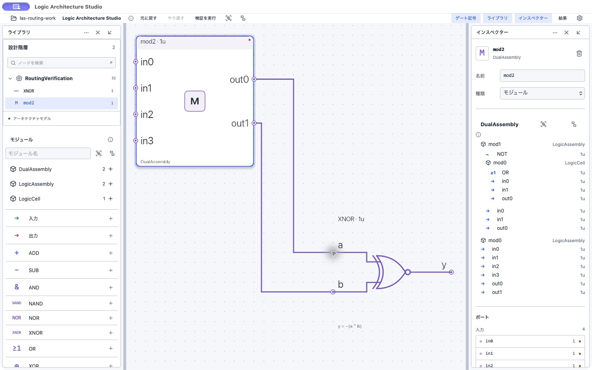

# Reusable modules — semantics and verification

Implemented 2026-11-16. Rust owns the saved module library and graph. Native GPU rendering and WebView panels consume the same typed state and commands.

## Workflow

1. Select processing nodes in the canvas or hierarchy list. Modifier-click adds/removes selections.
2. Use the group icon. The library offers an optional HDL identifier field; the toolbar chooses a unique name automatically.
3. Click a definition in the module library to instantiate it again. Instance register state is independent.
4. Group existing instances with other nodes to create a larger module. The inspector tree reveals nested definitions.
5. Expand a selected instance one level to edit its nodes. Regroup under a new definition name afterward. Existing definitions and other instances remain unchanged.

Top-level input/output nodes remain outside a group so external signal names and saved stimulus columns stay valid. Incoming connections from the same external output share one input boundary. Outgoing signals and unused selected outputs become module outputs. Unconnected input ports are exposed for later wiring. Width and signedness belong to each port, including modules with heterogeneous outputs.

Definitions are immutable shared snapshots stored in `Document.modules`. A module node references a definition and caches its typed interface; validation requires that cache to match exactly. Edges use `source_port`, defaulting to `y` for legacy circuits. Group/place/expand are revision-checked atomic changes with Undo/Redo and durable persistence. Module changes are included in native and WebView deltas.

## Execution and boundaries

Simulation, stimulus execution, external HDL comparisons and Verilog output elaborate instances into primitive nodes with deterministic, independently scoped identifiers. Boundary buffers preserve width/signedness and register feedback. The saved graph remains hierarchical; **generated Verilog is currently flat**. VCD/traces expose elaborated internal signals. Module blocks do not yet display separate values for every output port.

Recursive references, invalid interfaces, multiple drivers, incompatible widths/signedness and flattened combinational cycles are rejected. Limits are 64 definitions, 16 inputs and 16 outputs per definition, 16 nested instances, 2,000 expanded nodes and 8,000 expanded connections. A grouping selection is limited to 512 processing nodes. Shared-definition editing, canvas drilldown, parameter overrides and hierarchy-preserving HDL are not implemented.

## Verification

- Core module tests: combinational equivalence before/after grouping, nesting and expansion; repeated definitions; JSON round trip; invalid/recursive definitions; stale revisions and Undo; signed sequential/reset equivalence; independent register values with distinct inputs; expansion of module output-to-input feedback.
- Service test `modules_persist_and_replay_in_native_delta`: exact native delta replay, Rust evaluation and workspace reopen.
- Renderer retained tests: multiple typed output anchors and labels, equivalence with fresh projection; all 13 retained tests pass, including obstacle routing and preview/commit behavior.
- Web synchronization: library delta replay and recursive sequential detection pass (9 tests pass; optional external delta fixture test remains skipped).
- Actual installed Icarus and Verilator: `nested_modules_preserve_signed_pipeline_in_both_simulators` passes signed negative inputs/expectations, register/reset behavior, all-node comparison against Rust, VCD generation and external trace installation.
- `npm run bundle` and `cargo clippy --workspace --all-targets --locked -- -D warnings` pass. Existing dependency `block` emits a future-compatibility notice.

### Live UI checks

macOS native app, isolated `/tmp/las-routing-work` workspace, 1440 × 900 window; WebView development UI at `http://127.0.0.1:1427/`, controlled through CUA. Browser plugin skill was unavailable; CUA's documented browser/Playwright API was used.

Verified: OR → `LogicCell`; group with NOT → `LogicAssembly`; place a second copy; expand it back into NOT plus `LogicCell`; Undo restores the instance; modifier-select both copies and group → `DualAssembly`. Restart restores all three definitions and the three-level structure. Native inspector disclosure rows show the nested OR. Native library name-field clipping found during QA was fixed and visually rechecked.

The two `DualAssembly` outputs were individually connected to XNOR inputs through keyboard-accessible WebView ports. Native rendering shows separate output anchors and distinct orthogonal routes. Browser errors/warnings were empty after reconnecting following the deliberate service restart. No framework error overlay was present. Native pointer-port automation did not establish a connection in this environment; named-port editing was verified through WebView controls and native projection tests instead.

This validates module workflows and their integration with the renderer. It does not establish large hierarchical-design performance, all-platform pointer behavior or multi-monitor panel behavior.
